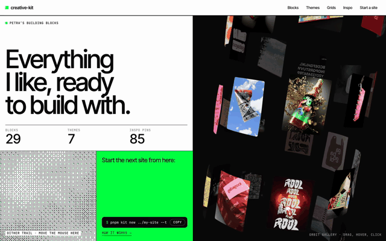

# creative-kit



My building blocks for creative websites: motion, effects, themes, grids and an inspiration library, with a showcase site that runs everything live.

## Manifesto

Most of what's in here started on someone else's website. The exception is everything from Iva's portfolio, which I built myself.

These are things I like, collected to build with. Bring them into new sites, motion and all, and let each one grow into that site's vibe, vision and context along the way.

The hope is that one day every animation, block and theme in here gets replaced by our own version of it, made while building new sites.

What "made, not generated" means in practice, with dos, don'ts and a test for every page: [content/research/creative-sites.md](content/research/creative-sites.md).

```sh
pnpm install
pnpm dev          # the showcase site
pnpm kit list     # every block and theme
```

## Start a new site

```sh
pnpm kit new ../my-site --theme graphite --blocks melt-text,orbit-gallery --install
cd ../my-site && pnpm dev
```

## The process

The kit is also my guide for designing a site, step by step:

1. **Brief** · 2. **Research** · 3. **Concept** · 4. **Content and structure** · 5. **Visual system** · 6. **Layout** · 7. **Motion** · 8. **Build** · 9. **Critique** · 10. **Launch** · 11. **Look back**

Each step says what question it answers, what to do, which skill or tool helps and when it's done: [PROCESS.md](PROCESS.md), or `/process` on the kit site (with a launch checklist to tick). The [field guide](FIELD-GUIDE.md) (`/guide`) explains the design principles behind it (hierarchy, scale, space, grid, type, colour, motion…) with pins from my own library, each with a way to check it and a study to practise it.

Three skills carry the steps, in any repo:

| Skill | Steps | What it does |
|---|---|---|
| `site-concept` | 1–3 | Brief, research through the kit and the galleries, 2–3 concepts on a board, a prototype of the signature moment, `concept/CONCEPT.md` |
| `site-layout` | 4–6 | Sitemap, sections and real copy (`CONTENT.md`), a specimen page to tune type and colour on that copy, grey-box wireframes with options at phone and desktop width (`LAYOUT.md`) |
| `design-review` | 9–10 | Screenshots at three widths, automatic checks (type, colour, contrast, spacing, phone, focus, reduced motion, weight) and a ranked review against the concept and the field guide. `--launch` adds the pre-launch checks |

## Studies

Small pieces to practise one thing: one HTML file each, in GSAP or [p5.js](https://p5js.org/), shown at `/studies`.

```sh
pnpm kit study hierarchy          # named after a principle: its practice becomes the brief
pnpm kit study dot-grid --p5      # a p5.js sketch
```

## Come up with a concept

```sh
pnpm kit skills   # once (and after new skills): links the kit's skills into ~/.claude/skills
```

Then, in any repo, ask Claude Code for a concept for the new site (the `site-concept` skill). It goes through the whole kit, the galleries and ABC Dinamo, proposes 2–3 concepts on a visual board (each showing the inspo pins it grows from, and any blocks, themes or grids it builds on), prototypes the signature moment of the one you pick as a small working page, and then turns it into `concept/CONCEPT.md`: idea, visual system, pages, motion, and what to take from the kit and how to change it.

## Add blocks to an existing site

```sh
pnpm kit add work-index dither-reveal --to ../my-site --install
pnpm kit theme cinnabar --to ../my-site
```

Blocks are copied in as source (into `src/components/kit/`), so each site can change them freely.

## Where to look

**Start with [content/research/start-here.md](content/research/start-here.md)**: six portfolios Petra picked herself, the first ones to look at.

Galleries with good website inspo (especially **[minimal.gallery](https://minimal.gallery/websites/)**):
[minimal.gallery](https://minimal.gallery/websites/) · [Site of Sites](https://www.siteofsites.co/?p=1) · [Godly](https://godly.website/) · [Httpster](https://httpster.net) · [Mindsparkle Mag](https://mindsparklemag.com/websites) · [Woo-hu](https://woo-hu.com/)

Fonts: [ABC Dinamo](https://abcdinamo.com/) (paid, with trial fonts for mockups).

Tools: GSAP and Lenis for motion, three.js for 3D, and [p5.js](https://p5js.org/) when I want something generative or drawn (patterns, particles, type made of shapes).

The list lives in `content/sources.json` and shows on the site's Inspo page.

## What's inside

| Folder | What |
|---|---|
| `registry/blocks/` | Blocks: component, live demo, `meta.json` |
| `registry/lib/` | GSAP + Lenis setup, theme token reader, base CSS |
| `themes/` | Themes as JSON (colours, fonts, type scale, easing, radius) |
| `content/inspo/` | Inspiration pins + screenshots |
| `content/process.json`, `content/field-guide.json` | The process and the field guide (`pnpm kit docs` writes `PROCESS.md` and `FIELD-GUIDE.md` from them) |
| `studies/` | Practice pieces, one HTML file each |
| `templates/starter/` | New-site template |
| `skills/` | Claude Code skills for other repos (`pnpm kit skills` links them) |
| `apps/site/` | The showcase website |
